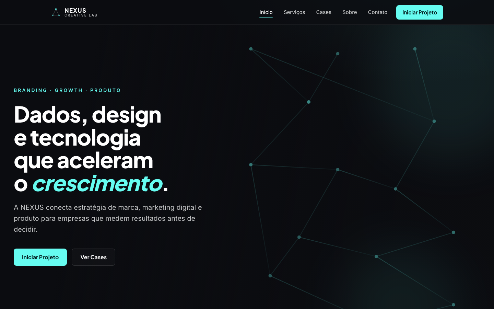
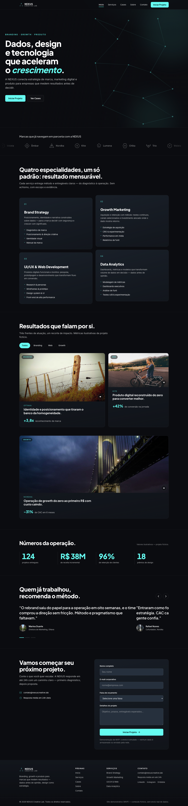
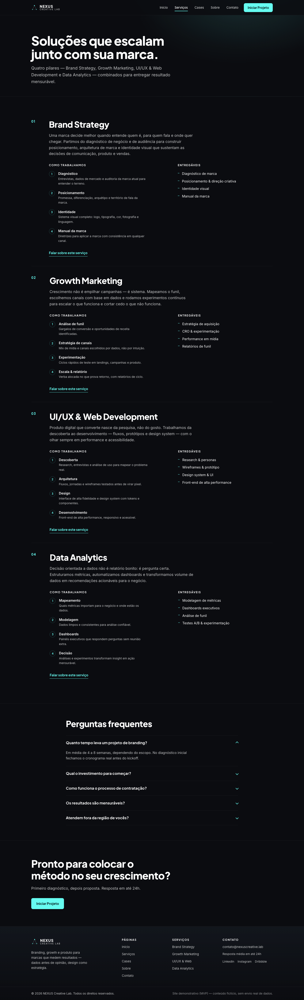
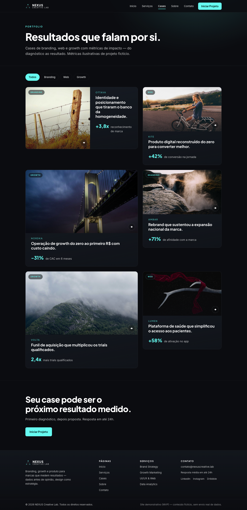
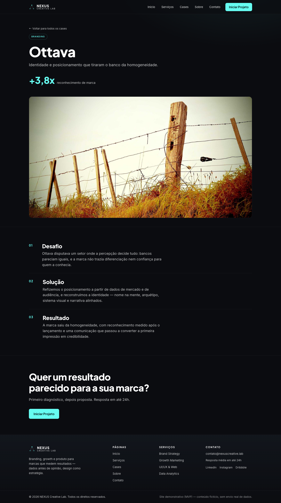
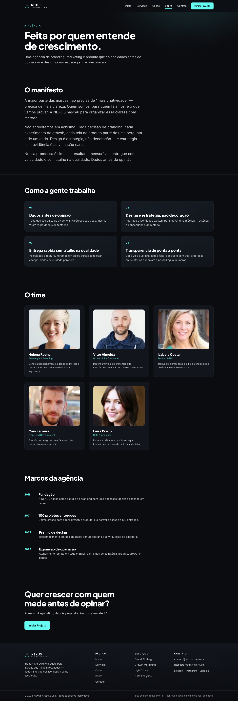
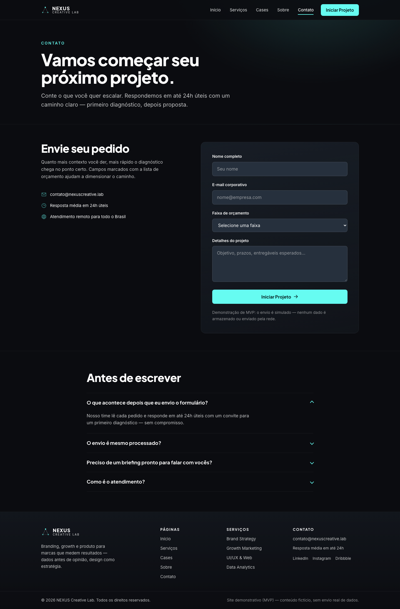

# NEXUS Creative Lab

> Website institucional (MVP) de uma agência fictícia de branding, growth e
> produtos digitais — construído como projeto de portfólio para testar, na prática,
> a skill **Harness Engineering PRD**.




## Sobre o projeto

A **NEXUS Creative Lab** é uma agência fictícia de branding, marketing digital e
desenvolvimento de produtos digitais. Este repositório contém o site institucional
em modo MVP: uma Home rica em seções (hero, marcas, serviços, cases, métricas,
depoimentos e contato) mais quatro páginas internas (Serviços, Cases, Sobre e
Contato) e uma página de detalhe de estudo de caso.

Tudo sem backend: o formulário de contato é **UI-only** e exibe um estado de sucesso
simulado, e todo o conteúdo (clientes, cases, depoimentos, time) é fictício.

## Por que este projeto existe

O objetivo não era apenas "fazer um site", e sim **validar de ponta a ponta a skill
[harness-engineering-prd](https://github.com/andsantodev/harness-engineering-prd)** —
uma skill que transforma a descrição de um projeto em um **PRD** e em um "pacote
Harness" (`AGENTS.md`, `feature_list.json`, `progress.md`, `session-handoff.md`) para
que um agente de codificação trabalhe de forma confiável entre múltiplas sessões, sem
perder contexto.

O fluxo seguido foi:

1. **Entrevista** — interrogatório adaptativo que testa a ideia antes de qualquer documento.
2. **PRD** — gerado, apresentado e aprovado explicitamente.
3. **Pacote Harness** — só então os arquivos de instrução e estado foram gerados.
4. **Execução** — implementação **uma feature por vez** (WIP = 1), com comando de
   verificação rodado a cada passo e evidência registrada.

Os artefatos gerados ficaram versionados neste repositório (em `docs/` e na raiz) e
são, eles mesmos, parte da demonstração do método.

## Screenshots

### Home completa



### Serviços



### Cases



### Detalhe de um case



### Sobre



### Contato



## Funcionalidades

- **Home** com as 7 seções do PRD: hero com fundo dinâmico, marquee de clientes,
  grid de serviços, galeria de cases com filtro, contadores de métricas animados,
  carrossel de depoimentos e formulário de contato.
- **Serviços** — os 4 serviços expandidos com processo, entregáveis, FAQ e CTAs.
- **Cases** — grid com filtro reutilizado e rota de detalhe com a estrutura
  **Desafio → Solução → Resultado**, métrica de impacto em destaque.
- **Sobre** — manifesto, valores, grid do time e linha do tempo.
- **Contato** — formulário dedicado (reutilizado da Home), informações
  complementares e FAQ.
- **Responsividade** — layout adaptável de mobile a desktop ultrawide.
- **Acessibilidade** — navegação por teclado, `aria-*` nos controles interativos,
  suporte a `prefers-reduced-motion`.

## Stack

- **Vue 3.5** + **Vite 8** (SPA) + **Vue Router 4**
- **CSS puro** com sistema de design tokens (`src/styles/tokens.css`)
- **@phosphor-icons/vue** para ícones
- **@fontsource** — Inter e Plus Jakarta Sans self-hosted (apenas subset latin)
- **Vitest** + **@vue/test-utils** + **jsdom** para testes
- Sem backend, sem banco de dados

## Como rodar

```bash
npm install
npm run dev        # servidor de desenvolvimento
npm run build      # build de produção (dist/)
npm run preview    # pré-visualiza o build
npm run test:unit  # roda a suíte de testes (Vitest)
```

## Estrutura de pastas

```
docs/                 PRD, referência de design e imagens
src/
  components/         componentes de UI (Home, header/footer, form...)
  views/              páginas roteadas (Home, Serviços, Cases, Sobre, Contato, 404)
  data/               conteúdo fictício (serviços, cases, métricas, time)
  styles/             design tokens e fontes
  router/             rotas do sitemap
  __tests__/          testes (Vitest)
AGENTS.md             contrato do agente (convenções e limites do projeto)
feature_list.json     features com critérios de aceite e evidência de verificação
progress.md           log de progresso por sessão
session-handoff.md    estado atual e próximo passo
```

## Metodologia Harness

Este projeto foi desenvolvido sob o método **Harness Engineering**. Os artefatos que
o tornam reproduzível e retomável estão versionados:

| Arquivo | Papel |
| --- | --- |
| [`docs/PRD.md`](docs/PRD.md) | Requisitos, escopo, não-objetivos, fases |
| [`feature_list.json`](feature_list.json) | 14 features com critérios de aceite e evidência |
| [`AGENTS.md`](AGENTS.md) | Convenções, limites e comandos de verificação |
| [`progress.md`](progress.md) | Log de cada sessão (o que foi feito e verificado) |
| [`session-handoff.md`](session-handoff.md) | Estado atual e próximo passo sugerido |

## Qualidade

- **81 testes** automatizados (Vitest) cobrindo navegação, tokens de design, todas as
  seções da Home e todas as páginas internas.
- **QA de responsividade**: 6 rotas × 4 viewports (375/768/1280/2560), verificando
  ausência de links mortos e renderização de todas as páginas.
- Build de produção validado (`vite build`).

## Limitações conhecidas

- O formulário de contato **não envia dados** — a submissão é simulada no front
  (decisão de escopo do MVP, sem backend).
- Todo o conteúdo é **fictício**; imagens usam placeholders (`picsum.photos` e
  `randomuser.me`).
- **ESLint não configurado** (`npm run lint` ainda pendente).

## Créditos

- Skill **[harness-engineering-prd](https://github.com/andsantodev/harness-engineering-prd)** —
  metodologia de PRD + Harness usada no projeto.
- Skill **[design-taste-frontend](https://github.com/Leonxlnx/taste-skill)** — usada
  como guia para todas as decisões de UI.

## Licença

Projeto de portfólio, **sem licença open-source** — todos os direitos reservados.
O conteúdo (marca, cases, depoimentos e time) é fictício e não representa nenhuma
empresa real.
